# US Layoffs Tracker (2023 – today)

How many people are being laid off in the United States, where, when, and how big are the layoffs?
This project collects layoff data from **official public sources**, checks them against each other
and against a widely cited private tracker, and summarizes them by **year, quarter, month, state, city and layoff size**.

**Tools:** Python (pandas, requests, matplotlib), BLS Public Data API, U.S. Department of Labor open data,
state WARN notices via Stanford Big Local News `warn-scraper`.

## Data sources

No single source tells the whole story, so each one checks the others.

| Source | Who publishes it | What it counts | Strength | Limitation |
|---|---|---|---|---|
| **JOLTS** layoffs & discharges | U.S. Bureau of Labor Statistics | Every employer-initiated separation, all business sizes | Official, complete national picture | Includes firings; state data are model estimates released once a year |
| **ETA-539** initial claims | U.S. Department of Labor | People filing for unemployment, weekly | Fast (about 1 week behind) | Not every laid-off worker files |
| **WARN** notices | State labor departments | Individual large layoffs: company, city, date, workers | Company and city detail | Large layoffs only; some states' data can't be collected |
| **BED** gross job losses | U.S. Bureau of Labor Statistics | Jobs lost at shrinking or closing businesses, by quarter | Covers every business size | About 7 months behind |
| **Challenger** job-cut announcements *(reference only)* | Challenger, Gray & Christmas (private research firm) | Job cuts companies **announce** | The tracker most often quoted in the news | Plans, not confirmed layoffs; entered by hand from monthly reports |

## Results

<!-- RESULTS:START -->
_Last updated November 05, 2026. Generated automatically by `make_charts.py`._

**Data current as of:** BLS JOLTS through **September 2026** · WARN notices through **November 04, 2026** · unemployment claims through **October 2026**

### Key numbers

| Measure | Value |
|---|---|
| US layoffs & discharges in 2025 (BLS) | **21.24M** |
| Change vs 2024 | **+6.1%** |
| 2026 so far (9 months), average per month | **1.71M** |
| Latest month (September 2026, preliminary) | **1.77M** |
| WARN notices since 2023 (29 states) | **10,122** notices, **894K** workers |

### Findings

- BLS counted **21.24M** layoffs and discharges in 2025, **+6.1%** compared with 2024 (20.01M).
- Through September 2026, 2026 averages **1.71M a month**, **-3.3%** versus the 2025 monthly average.
- Seasonal pattern (full years): **Jan** and **Dec** are usually the highest months (+32% and +15% vs. the yearly average); **Mar** and **Feb** are usually the lowest.
- Highest month each year: 2023 **Jan** (2.35M), 2024 **Jan** (2.10M), 2025 **Jan** (2.25M), 2026 **Jan** (2.17M).
- States with the most layoffs and discharges in 2025: **CA** (2.4M), **TX** (1.7M), **NY** (1.5M).
- Notices of 1,000+ workers were **0.5%** of WARN notices but **12.8%** of the workers named in them.
- Largest single WARN notice since 2023: **Tend Exchange Subsidiary LLC and Delaware Tender Staffing
LLC** (nan, CA), **16,132** workers, May 2025.
- Company with the most workers in WARN notices since 2023: **Tend Exchange Subsidiary LLC and Delaware Tender Staffing LLC**, **16,132** workers across 1 notices (CA).
- Notices are filed most often on **Wed** (22%); only 1% on weekends. Layoffs most often take effect on **Fri** (26%).
- Most common start dates in the month: **day 31** (9% of layoffs), then day 30 (9%) and day 1 (6%).
- Busiest single day: **May 20, 2025** (Tuesday), 4 notices covering **16,364** workers.
- Trend match with BLS (rank correlation, 1 = same direction every month): unemployment claims **0.28**, WARN **-0.34**.

### Charts

<picture>
  <source media="(prefers-color-scheme: dark)" srcset="docs/charts/bls_monthly-dark.png">
  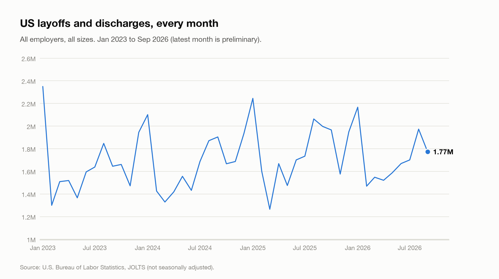
</picture>

<picture>
  <source media="(prefers-color-scheme: dark)" srcset="docs/charts/bls_yearly-dark.png">
  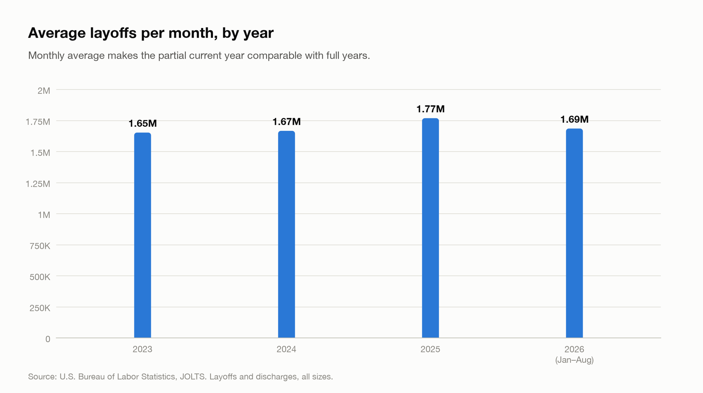
</picture>

| Year | Months | Total | Average per month |
|---|---|---|---|
| 2023 | 12 | 19.85M | 1.65M |
| 2024 | 12 | 20.01M | 1.67M |
| 2025 | 12 | 21.24M | 1.77M |
| 2026 | 9 | 15.41M | 1.71M |

#### Monthly pattern

<picture>
  <source media="(prefers-color-scheme: dark)" srcset="docs/charts/month_year_heatmap-dark.png">
  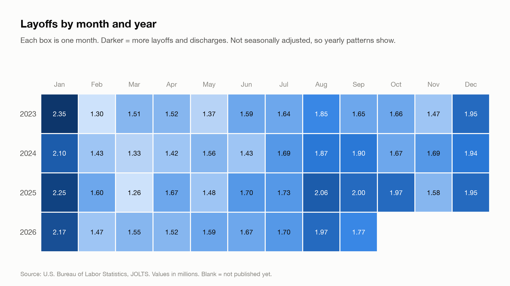
</picture>

<picture>
  <source media="(prefers-color-scheme: dark)" srcset="docs/charts/same_month_by_year-dark.png">
  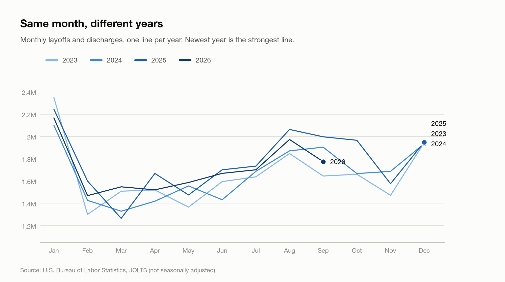
</picture>

#### Do the sources agree?

<picture>
  <source media="(prefers-color-scheme: dark)" srcset="docs/charts/sources_trend-dark.png">
  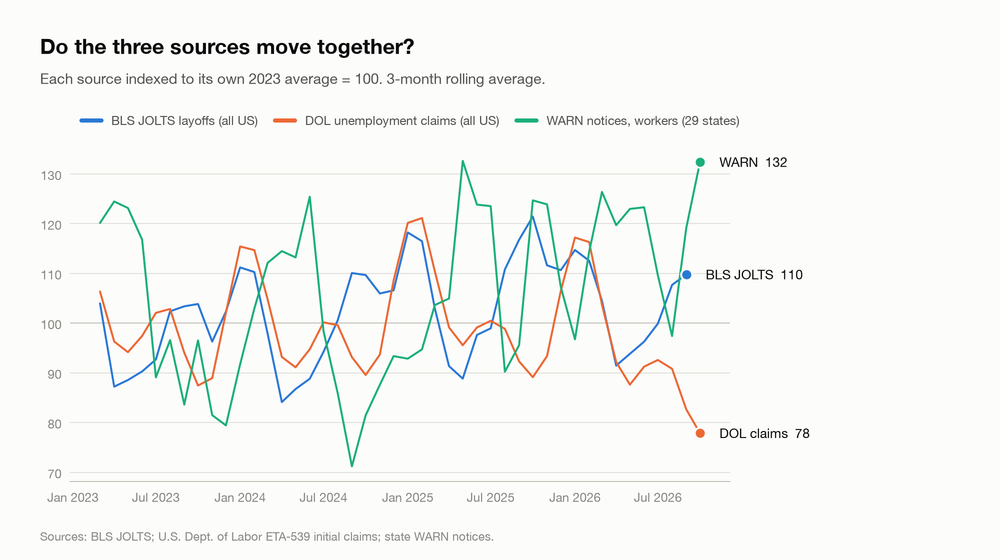
</picture>

#### Compared with other trackers

| Year | BLS JOLTS layoffs & discharges | DOL initial unemployment claims | Challenger announced job cuts | WARN workers (29 states) |
|---|---|---|---|---|
| 2023 | 19.85M | 11.39M | 722K | 217K |
| 2024 | 20.01M | 11.38M | 761K | 219K |
| 2025 | 21.24M | 11.56M | 1.21M | 234K |
| 2026 | 15.41M (9 mo) | 8.81M (10 mo) | 617K (10 mo) | 224K (10 mo) |

_(n mo) = months available so far. Challenger, Gray & Christmas figures are entered from their monthly reports (see `reference/challenger_job_cuts.csv` for each source link)._

**Why the numbers differ:** BLS counts every layoff *and* firing, at every employer. DOL claims count people who **applied** for unemployment benefits. Challenger counts job cuts **announced** by companies (plans, which may happen later or not at all). WARN counts large layoffs that legally required advance notice. They measure different things, so the levels differ; what matters is whether they **rise and fall together**.

<picture>
  <source media="(prefers-color-scheme: dark)" srcset="docs/charts/top_states-dark.png">
  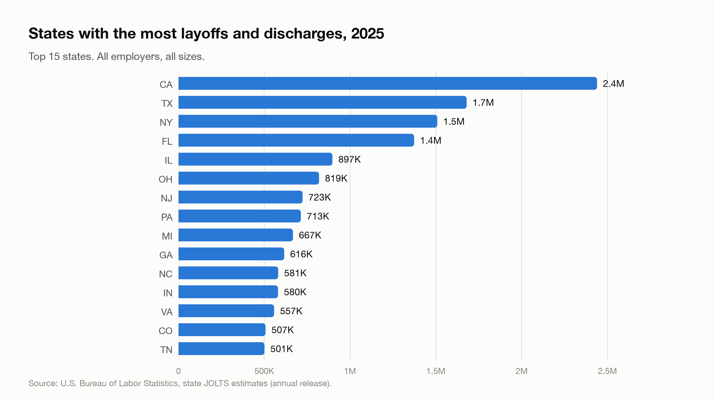
</picture>

<details><summary>All states table</summary>

| Rank | State | Layoffs & discharges |
|---|---|---|
| 1 | CA | 2.4M |
| 2 | TX | 1.7M |
| 3 | NY | 1.5M |
| 4 | FL | 1.4M |
| 5 | IL | 897K |
| 6 | OH | 819K |
| 7 | NJ | 723K |
| 8 | PA | 713K |
| 9 | MI | 667K |
| 10 | GA | 616K |
| 11 | NC | 581K |
| 12 | IN | 580K |
| 13 | VA | 557K |
| 14 | CO | 507K |
| 15 | TN | 501K |
| 16 | MA | 447K |
| 17 | WA | 401K |
| 18 | AZ | 388K |
| 19 | WI | 374K |
| 20 | SC | 326K |
| 21 | MN | 324K |
| 22 | MO | 317K |
| 23 | MD | 304K |
| 24 | KY | 279K |
| 25 | ID | 276K |
| 26 | LA | 268K |
| 27 | NV | 261K |
| 28 | CT | 252K |
| 29 | UT | 245K |
| 30 | AL | 240K |
| 31 | OR | 230K |
| 32 | OK | 219K |
| 33 | IA | 200K |
| 34 | KS | 191K |
| 35 | AR | 170K |
| 36 | MS | 151K |
| 37 | NE | 133K |
| 38 | NM | 113K |
| 39 | NH | 109K |
| 40 | ME | 96.0K |
| 41 | MT | 95.0K |
| 42 | RI | 93.0K |
| 43 | WV | 84.0K |
| 44 | DC | 74.0K |
| 45 | HI | 72.0K |
| 46 | ND | 68.0K |
| 47 | SD | 67.0K |
| 48 | DE | 64.0K |
| 49 | AK | 56.0K |
| 50 | VT | 46.0K |
| 51 | WY | 44.0K |

</details>

<picture>
  <source media="(prefers-color-scheme: dark)" srcset="docs/charts/top_cities-dark.png">
  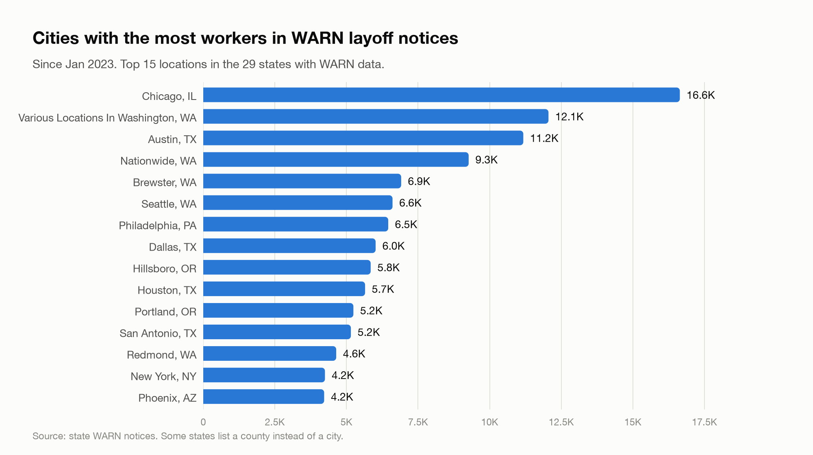
</picture>

| City | State | WARN notices | Workers |
|---|---|---|---|
| Chicago | IL | 23 | 16,639 |
| Various Locations In Washington | WA | 35 | 12,053 |
| Austin | TX | 60 | 11,174 |
| Nationwide | WA | 1 | 9,266 |
| Brewster | WA | 2 | 6,910 |
| Seattle | WA | 61 | 6,608 |
| Philadelphia | PA | 63 | 6,458 |
| Dallas | TX | 35 | 6,018 |
| Hillsboro | OR | 25 | 5,845 |
| Houston | TX | 55 | 5,650 |
| Portland | OR | 65 | 5,242 |
| San Antonio | TX | 47 | 5,154 |
| Redmond | WA | 19 | 4,642 |
| New York | NY | 58 | 4,249 |
| Phoenix | AZ | 46 | 4,221 |

<picture>
  <source media="(prefers-color-scheme: dark)" srcset="docs/charts/size_mix-dark.png">
  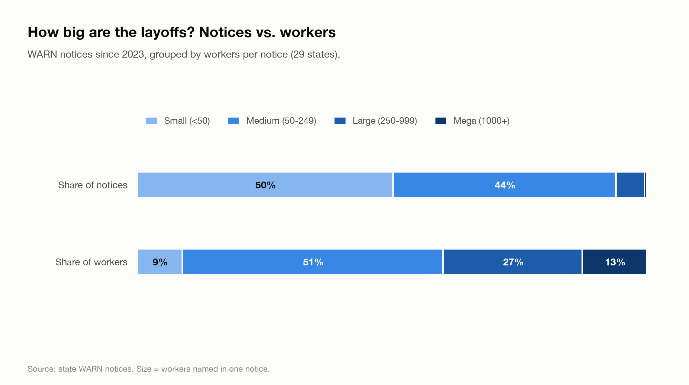
</picture>

| Layoff size | Notices | Share of notices | Workers | Share of workers |
|---|---|---|---|---|
| Small (<50) | 4,815 | 50.1% | 78,746 | 8.8% |
| Medium (50-249) | 4,201 | 43.8% | 456,004 | 51.0% |
| Large (250-999) | 540 | 5.6% | 245,242 | 27.4% |
| Mega (1000+) | 46 | 0.5% | 113,986 | 12.8% |

### Companies, dates and calendar patterns

_From WARN notices only (29 states): the one source with exact dates and company names._

#### Companies with the most layoffs

<picture>
  <source media="(prefers-color-scheme: dark)" srcset="docs/charts/top_companies-dark.png">
  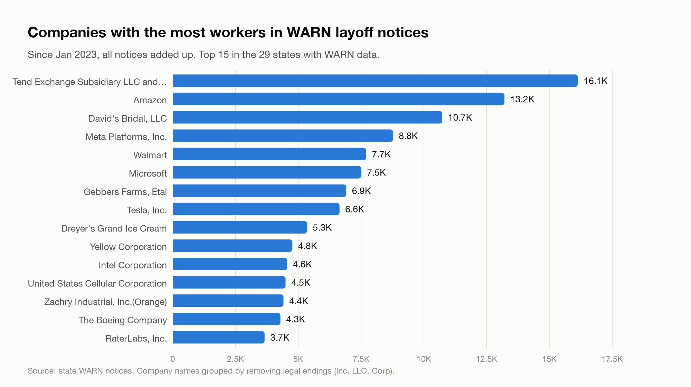
</picture>

| Rank | Company | Workers | Notices | States | Latest notice |
|---|---|---|---|---|---|
| 1 | Tend Exchange Subsidiary LLC and Delaware Tender Staffing LLC | 16,132 | 1 | CA | May 20, 2025 |
| 2 | Amazon | 13,211 | 88 | CA, NJ, NY, PA, WA | Nov 03, 2026 |
| 3 | David's Bridal, LLC | 10,732 | 42 | AK, AL, CA, ME, NE, NJ, TX, WA, WI | Aug 26, 2023 |
| 4 | Meta Platforms, Inc. | 8,775 | 84 | CA, NJ, WA | May 26, 2026 |
| 5 | Walmart | 7,701 | 49 | AL, CA, IL, KS, MD, NJ, TX, WA, WI | Jun 23, 2026 |
| 6 | Microsoft | 7,505 | 28 | CA, WA | Sep 22, 2026 |
| 7 | Gebbers Farms, Etal | 6,910 | 2 | WA | Sep 25, 2026 |
| 8 | Tesla, Inc. | 6,642 | 33 | CA, MD, TX | May 13, 2024 |
| 9 | Dreyer's Grand Ice Cream | 5,349 | 12 | CA, MD | Oct 21, 2026 |
| 10 | Yellow Corporation | 4,764 | 42 | AL, CA, KS, ME, WA, WI | Aug 18, 2023 |
| 11 | Intel Corporation | 4,555 | 65 | AZ, CA, PA, TX | Oct 22, 2026 |
| 12 | United States Cellular Corporation | 4,493 | 6 | CA, NE, TN, WA | Apr 17, 2025 |
| 13 | Zachry Industrial, Inc.(Orange) | 4,410 | 4 | TX | Jun 03, 2024 |
| 14 | The Boeing Company | 4,287 | 32 | AL, AZ, CA, PA, SC, WA | Apr 13, 2026 |
| 15 | RaterLabs, Inc. | 3,657 | 1 | WA | Feb 06, 2024 |

Full list: [docs/tables/top_companies.csv](docs/tables/top_companies.csv)

#### Day by day

<picture>
  <source media="(prefers-color-scheme: dark)" srcset="docs/charts/recent_daily-dark.png">
  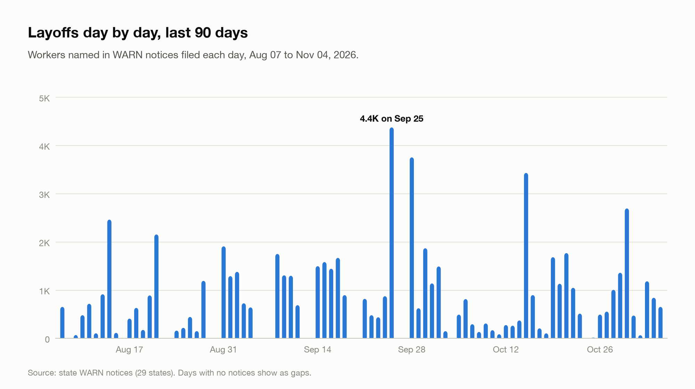
</picture>

**Latest notices**

| Date | Company | City | State | Workers |
|---|---|---|---|---|
| Nov 04, 2026 | Alphia, Inc | nan | NE | 93 |
| Nov 04, 2026 | Seattle Marriott Redmond | Redmond | WA | 91 |
| Nov 04, 2026 | Crinetics Pharmaceuticals, Inc. | nan | CA | 78 |
| Nov 04, 2026 | JVS SoCal | nan | CA | 63 |
| Nov 04, 2026 | Ubs | Weehawken | NJ | 58 |
| Nov 04, 2026 | ServiceNow, Inc. | nan | CA | 37 |
| Nov 04, 2026 | Eclipse Advantage, LLC | nan | CA | 35 |
| Nov 04, 2026 | Quince & Co, LLC | nan | CA | 34 |
| Nov 04, 2026 | JVS SoCal | nan | CA | 33 |
| Nov 04, 2026 | AES Corporation | nan | CA | 28 |
| Nov 04, 2026 | ServiceNow, Inc. | nan | CA | 25 |
| Nov 04, 2026 | Chick-fil-A - Hollins Group LLC - La Palma | nan | CA | 24 |
| Nov 04, 2026 | Chick-fil-A - Hollins Group LLC - Orangethorpe | nan | CA | 14 |
| Nov 04, 2026 | AES Corporation | nan | CA | 13 |
| Nov 04, 2026 | City National Bank | nan | CA | 11 |

Every day since 2023: [docs/tables/daily_notices.csv](docs/tables/daily_notices.csv)

#### Day of the week and date in the month

<picture>
  <source media="(prefers-color-scheme: dark)" srcset="docs/charts/weekday_pattern-dark.png">
  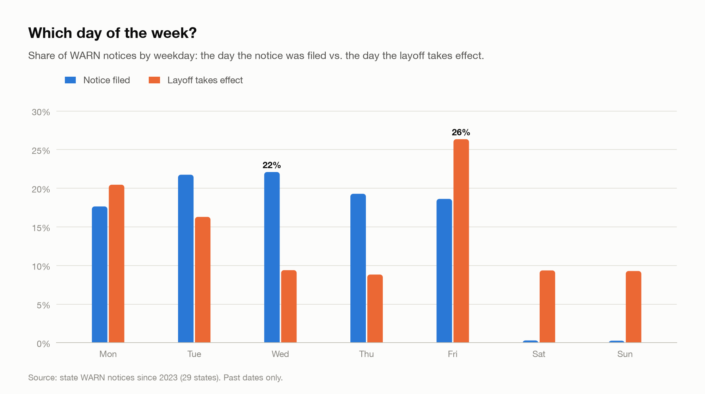
</picture>

<picture>
  <source media="(prefers-color-scheme: dark)" srcset="docs/charts/day_of_month_pattern-dark.png">
  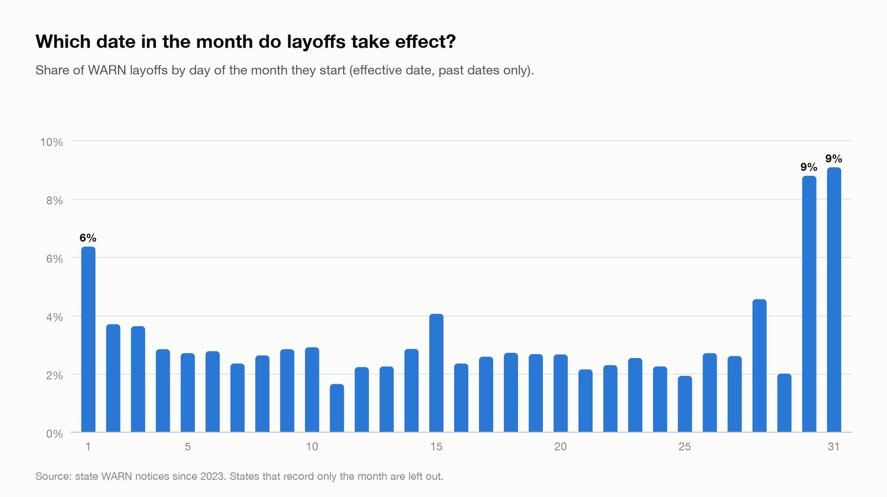
</picture>

| Weekday | Notices filed | Share | Layoffs taking effect | Share |
|---|---|---|---|---|
| Mon | 1,573 | 17.7% | 1,837 | 20.5% |
| Tue | 1,939 | 21.8% | 1,463 | 16.3% |
| Wed | 1,970 | 22.1% | 844 | 9.4% |
| Thu | 1,719 | 19.3% | 793 | 8.8% |
| Fri | 1,660 | 18.6% | 2,366 | 26.4% |
| Sat | 27 | 0.3% | 841 | 9.4% |
| Sun | 24 | 0.3% | 834 | 9.3% |

_Based on 8,912 notices with a filing date and 8,978 layoffs that have already taken effect._

#### Month by month, with company names

| Month | Notices | Workers | Different companies | Biggest companies that month (workers) |
|---|---|---|---|---|
| November 2026 | 53 | 2,745 | 32 | Davey Tree Surgery Company (Remote) (368); Amazon (189); Community Tree Service, LLC (163) |
| October 2026 | 211 | 23,390 | 165 | Tyson Warehousing Services, LLC/Rochelle Distribution Center (2,495); Dreyer's Grand Ice Cream (2,346); AEG Management Oakland LLC (1,605) |
| September 2026 | 270 | 29,418 | 192 | Gebbers Farms, Etal (3,445); Covenant Aviation Security (Hobby Airport) (1,279); Legendary Fruit Co (1,220) |
| August 2026 | 236 | 19,184 | 176 | JBS Souderton (1,485); Borton & Sons, Inc. (928); 24Hr Homecare, LLC (738) |
| July 2026 | 194 | 16,169 | 155 | Electrolux Consumer Products, Inc. (1,245); FreshRealm, Inc. (628); Microsoft (605) |
| June 2026 | 251 | 17,604 | 166 | Lucid USA, Inc. (705); humano LLC (586); SIMOS Insourcing Solutions, LLC (572) |
| May 2026 | 253 | 25,834 | 187 | Meta Platforms, Inc. (4,665); Spirit Airlines (IAH) May 2026 (959); Intuit Inc. (910) |
| April 2026 | 320 | 23,603 | 228 | Amazon Fresh (983); Aramark Campus, LLC (972); Oracle America, Inc. (764) |
| March 2026 | 272 | 17,422 | 175 | First Brands Group, LLC (904); KBR Services LLC (758); Oracle America, Inc. (475) |
| February 2026 | 257 | 24,057 | 187 | Verizon (1,319); First Brands Group, LLC (907); Crothall and Morrison Healthcare (795) |
| January 2026 | 294 | 27,235 | 234 | Amazon (3,680); Tyson Foods, Inc (Amarillo B-Shift Operations) Updated (1,761); Amazon Fresh (1,281) |
| December 2025 | 110 | 10,888 | 89 | Blue Oval SK Group/Battery Plant (1,514); Novo Nordisk (811); Swift Beef Company (374) |

All months: [docs/tables/monthly_notices_companies.csv](docs/tables/monthly_notices_companies.csv)

<details><summary>Workers in WARN notices, month × year</summary>

| Year | Jan | Feb | Mar | Apr | May | Jun | Jul | Aug | Sep | Oct | Nov | Dec | Total |
|---|---|---|---|---|---|---|---|---|---|---|---|---|---|
| 2023 | 23,727 | 19,796 | 21,799 | 26,079 | 19,081 | 18,335 | 11,023 | 23,149 | 11,291 | 18,035 | 14,980 | 10,165 | 217,460 |
| 2024 | 24,737 | 21,064 | 15,157 | 26,022 | 20,380 | 21,790 | 11,312 | 13,605 | 13,789 | 16,892 | 16,937 | 16,931 | 218,616 |
| 2025 | 16,612 | 17,953 | 21,778 | 17,324 | 33,013 | 16,996 | 17,154 | 14,907 | 19,894 | 32,993 | 14,474 | 10,888 | 233,986 |
| 2026 | 27,235 | 24,057 | 17,422 | 23,603 | 25,834 | 17,604 | 16,169 | 19,184 | 29,418 | 23,390 | 2,745 | – | 226,661 |

</details>

### How to read this

- **BLS JOLTS** counts every employer-initiated separation (layoffs *and* firings), all business sizes. State numbers are model-based estimates and are released once a year (each July).
- **DOL claims** count people filing for unemployment. Not every laid-off worker files, so it's a trend signal.
- **WARN notices** cover larger layoffs only (usually 50+ workers at employers with 100+ staff), from the 29 states whose data could be collected. Cities come from WARN only.
- Sept and Oct 2025 BLS data were affected by the federal government shutdown.
- **Company names** are grouped by removing legal endings (Inc, LLC, Corp), so the same company in different states adds up. Different divisions with different names (for example a subsidiary) still count separately.
- **Dates:** a WARN notice is usually filed about 60 days before the layoff takes effect, so the "filed" and "takes effect" patterns differ on purpose.

<!-- RESULTS:END -->

## How it works

1. **Collect.** Downloads WARN notices state by state, monthly JOLTS and quarterly BED data from the BLS API, and weekly unemployment claims from the Department of Labor.
2. **Clean.** Every state formats its WARN file differently, so the program finds the company, city, worker and date columns by name *and* by checking what's inside them. It removes duplicates, impossible dates and invalid values, and labels preliminary or shutdown-affected months.
3. **Cross-check.** Compares the sources month by month and state by state, and flags anything impossible (for example, more WARN layoffs than the official total).
4. **Report.** Saves an Excel workbook with every table, then `make_charts.py` draws the charts, finds the seasonal pattern, compares with Challenger's figures, and writes the Results section above.

A `warn_column_map` sheet shows exactly which columns were used for each state, and `source_status` shows which sources and states worked on each run.

## Project structure

```
us_layoff_tracker/
├── us_layoffs_tracker.py          # main program: collect, clean, cross-check, save report
├── make_charts.py                 # charts + Results section (runs automatically after the main program)
├── requirements.txt               # Python packages needed
├── reference/
│   └── challenger_job_cuts.csv    # Challenger figures, one row per period, with source link
├── docs/
│   ├── charts/                    # charts (light + dark versions), created automatically
│   └── RESULTS.md                 # results page, created automatically
├── layoffs_output/                # Excel report + CSVs (not uploaded to GitHub)
└── warn_data/                     # downloaded WARN files (not uploaded to GitHub)
```

## Setup

```bash
conda create -n layoffs python=3.11 -y
conda activate layoffs
pip install -r requirements.txt
conda env config vars set BLS_API_KEY="your_key" CONTACT_EMAIL="you@email.com"
conda deactivate && conda activate layoffs
```

Get a free BLS API key: https://data.bls.gov/registrationEngine/

## Run

```bash
python us_layoffs_tracker.py               # everything: all 50 states + DC, report, charts, README (first run: 30–90 minutes)
python us_layoffs_tracker.py --skip-warn   # same, but reuse downloaded WARN files (about 1–2 minutes)
python us_layoffs_tracker.py --states MI   # one state, for testing
python make_charts.py                      # only rebuild charts and Results from the saved report
```

Outputs:
- `layoffs_output/us_layoffs_report.xlsx`: every table (one sheet each), plus CSV copies
- `docs/charts/`: charts in light and dark versions
- `docs/RESULTS.md` and the Results section of this README, updated automatically

## Keeping it up to date

- **BLS, DOL and WARN data** refresh automatically every time you run the program.
- **Challenger figures** don't have a download, so add one line to `reference/challenger_job_cuts.csv` when each monthly report comes out (early each month):
  ```
  2026-10,month,NUMBER_FROM_REPORT,LINK_TO_REPORT
  ```
- **A state whose WARN data can't be downloaded:** save the state's official WARN list as `warn_data/manual/<state>.xlsx` (for example `mi.xlsx`). It's used automatically.

## Limitations

- WARN covers mostly large layoffs (generally 50+ workers at employers with 100+ staff). Small layoffs are counted only in the BLS totals.
- Since 2026, BLS publishes **state** JOLTS data once a year (each July), so the newest state months lag the national data.
- BLS revises up to five years of data each January, so numbers can change between runs.
- September and October 2025 BLS data were affected by the federal government shutdown.
- Some states' WARN files list only a notice date or only a layoff date, and some list a county instead of a city.
- Challenger's 2024 figures are available by quarter only, and its 2022–2023 totals come from news coverage of its reports.
- State websites change, so some states may fail on a given day. Check the `source_status` sheet.