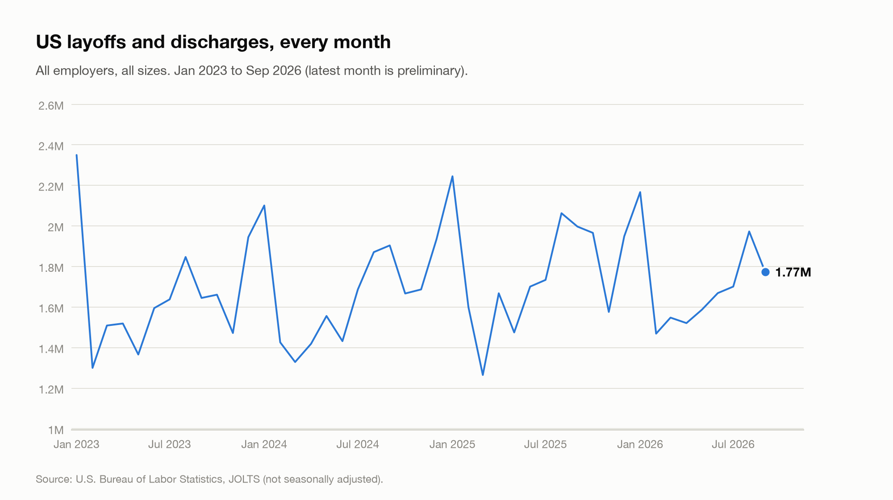
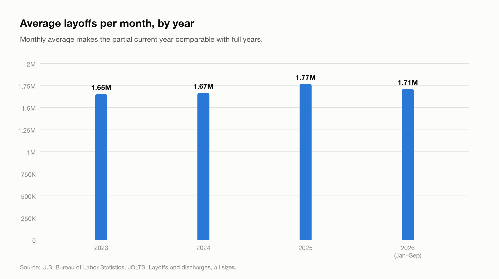
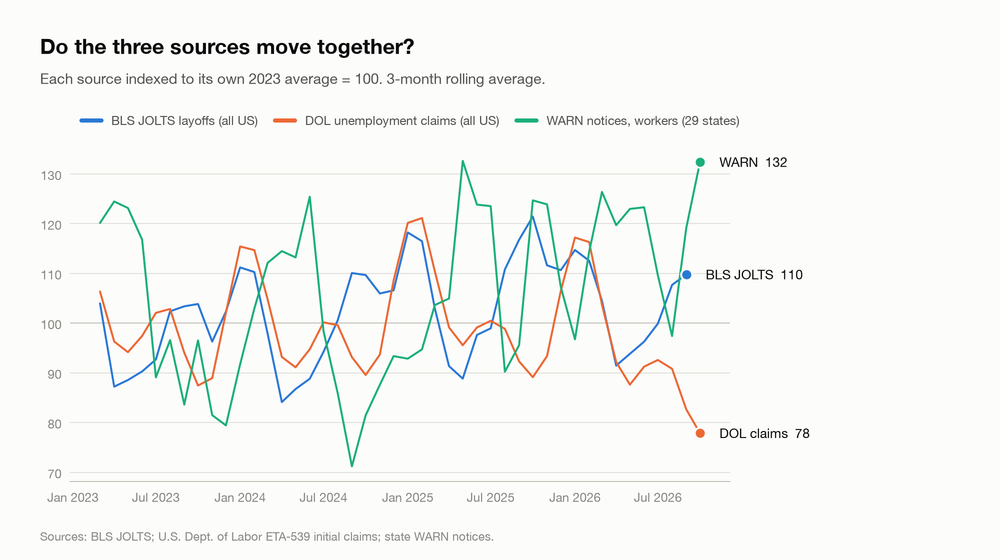
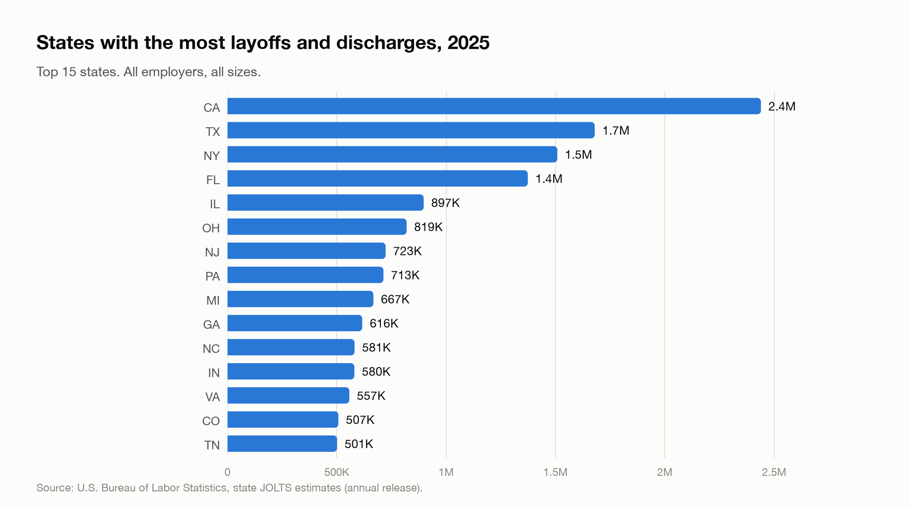
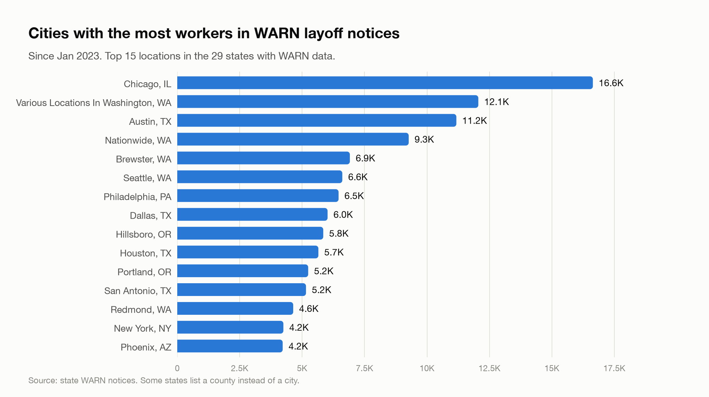
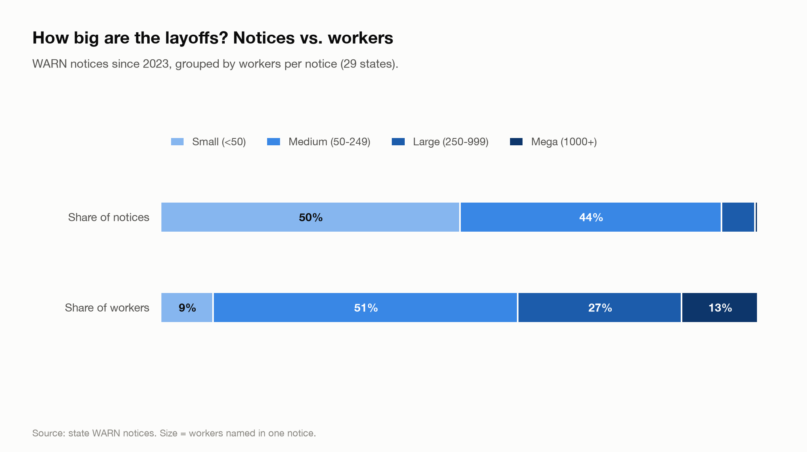

# Results

_Last updated November 05, 2026. Generated automatically by `make_charts.py`._

### Key numbers

| Measure | Value |
|---|---|
| US layoffs & discharges in 2025 (BLS) | **21.24M** |
| Change vs 2024 | **+6.1%** |
| 2026 so far (9 months), average per month | **1.71M** |
| Latest month (September 2026, preliminary) | **1.77M** |
| WARN notices since 2023 (29 states) | **10,122** notices, **894K** workers |

### Findings

- BLS counted **21.24M** layoffs and discharges in 2025, **+6.1%** compared with 2024 (20.01M).
- Through September 2026, 2026 averages **1.71M a month**, **-3.3%** versus the 2025 monthly average.
- States with the most layoffs and discharges in 2025: **CA** (2.4M), **TX** (1.7M), **NY** (1.5M).
- Notices of 1,000+ workers were **0.5%** of WARN notices but **12.8%** of the workers named in them.
- Largest single WARN notice since 2023: **Tend Exchange Subsidiary LLC and Delaware Tender Staffing
LLC** (nan, CA), **16,132** workers, May 2025.
- Trend match with BLS (rank correlation, 1 = same direction every month): unemployment claims **0.28**, WARN **-0.34**.

### Charts

<picture>
  <source media="(prefers-color-scheme: dark)" srcset="../docs/charts/bls_monthly-dark.png">
  
</picture>

<picture>
  <source media="(prefers-color-scheme: dark)" srcset="../docs/charts/bls_yearly-dark.png">
  
</picture>

| Year | Months | Total | Average per month |
|---|---|---|---|
| 2023 | 12 | 19.85M | 1.65M |
| 2024 | 12 | 20.01M | 1.67M |
| 2025 | 12 | 21.24M | 1.77M |
| 2026 | 9 | 15.41M | 1.71M |

<picture>
  <source media="(prefers-color-scheme: dark)" srcset="../docs/charts/sources_trend-dark.png">
  
</picture>

<picture>
  <source media="(prefers-color-scheme: dark)" srcset="../docs/charts/top_states-dark.png">
  
</picture>

All states table

| Rank | State | Layoffs & discharges |
|---|---|---|
| 1 | CA | 2.4M |
| 2 | TX | 1.7M |
| 3 | NY | 1.5M |
| 4 | FL | 1.4M |
| 5 | IL | 897K |
| 6 | OH | 819K |
| 7 | NJ | 723K |
| 8 | PA | 713K |
| 9 | MI | 667K |
| 10 | GA | 616K |
| 11 | NC | 581K |
| 12 | IN | 580K |
| 13 | VA | 557K |
| 14 | CO | 507K |
| 15 | TN | 501K |
| 16 | MA | 447K |
| 17 | WA | 401K |
| 18 | AZ | 388K |
| 19 | WI | 374K |
| 20 | SC | 326K |
| 21 | MN | 324K |
| 22 | MO | 317K |
| 23 | MD | 304K |
| 24 | KY | 279K |
| 25 | ID | 276K |
| 26 | LA | 268K |
| 27 | NV | 261K |
| 28 | CT | 252K |
| 29 | UT | 245K |
| 30 | AL | 240K |
| 31 | OR | 230K |
| 32 | OK | 219K |
| 33 | IA | 200K |
| 34 | KS | 191K |
| 35 | AR | 170K |
| 36 | MS | 151K |
| 37 | NE | 133K |
| 38 | NM | 113K |
| 39 | NH | 109K |
| 40 | ME | 96.0K |
| 41 | MT | 95.0K |
| 42 | RI | 93.0K |
| 43 | WV | 84.0K |
| 44 | DC | 74.0K |
| 45 | HI | 72.0K |
| 46 | ND | 68.0K |
| 47 | SD | 67.0K |
| 48 | DE | 64.0K |
| 49 | AK | 56.0K |
| 50 | VT | 46.0K |
| 51 | WY | 44.0K |

<picture>
  <source media="(prefers-color-scheme: dark)" srcset="../docs/charts/top_cities-dark.png">
  
</picture>

| City | State | WARN notices | Workers |
|---|---|---|---|
| Chicago | IL | 23 | 16,639 |
| Various Locations In Washington | WA | 35 | 12,053 |
| Austin | TX | 60 | 11,174 |
| Nationwide | WA | 1 | 9,266 |
| Brewster | WA | 2 | 6,910 |
| Seattle | WA | 61 | 6,608 |
| Philadelphia | PA | 63 | 6,458 |
| Dallas | TX | 35 | 6,018 |
| Hillsboro | OR | 25 | 5,845 |
| Houston | TX | 55 | 5,650 |
| Portland | OR | 65 | 5,242 |
| San Antonio | TX | 47 | 5,154 |
| Redmond | WA | 19 | 4,642 |
| New York | NY | 58 | 4,249 |
| Phoenix | AZ | 46 | 4,221 |

<picture>
  <source media="(prefers-color-scheme: dark)" srcset="../docs/charts/size_mix-dark.png">
  
</picture>

| Layoff size | Notices | Share of notices | Workers | Share of workers |
|---|---|---|---|---|
| Small (<50) | 4,815 | 50.1% | 78,746 | 8.8% |
| Medium (50-249) | 4,201 | 43.8% | 456,004 | 51.0% |
| Large (250-999) | 540 | 5.6% | 245,242 | 27.4% |
| Mega (1000+) | 46 | 0.5% | 113,986 | 12.8% |

### How to read this

- **BLS JOLTS** counts every employer-initiated separation (layoffs *and* firings), all business sizes. State numbers are model-based estimates and are released once a year (each July).
- **DOL claims** count people filing for unemployment. Not every laid-off worker files, so it's a trend signal.
- **WARN notices** cover larger layoffs only (usually 50+ workers at employers with 100+ staff), from the 29 states whose data could be collected. Cities come from WARN only.
- Sept and Oct 2025 BLS data were affected by the federal government shutdown.
